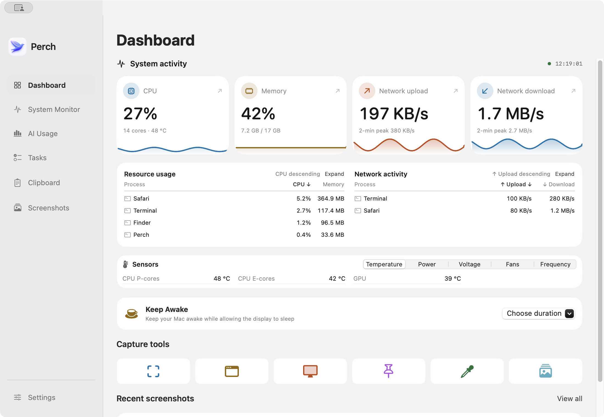
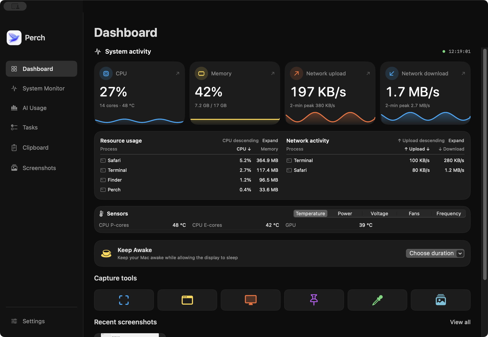
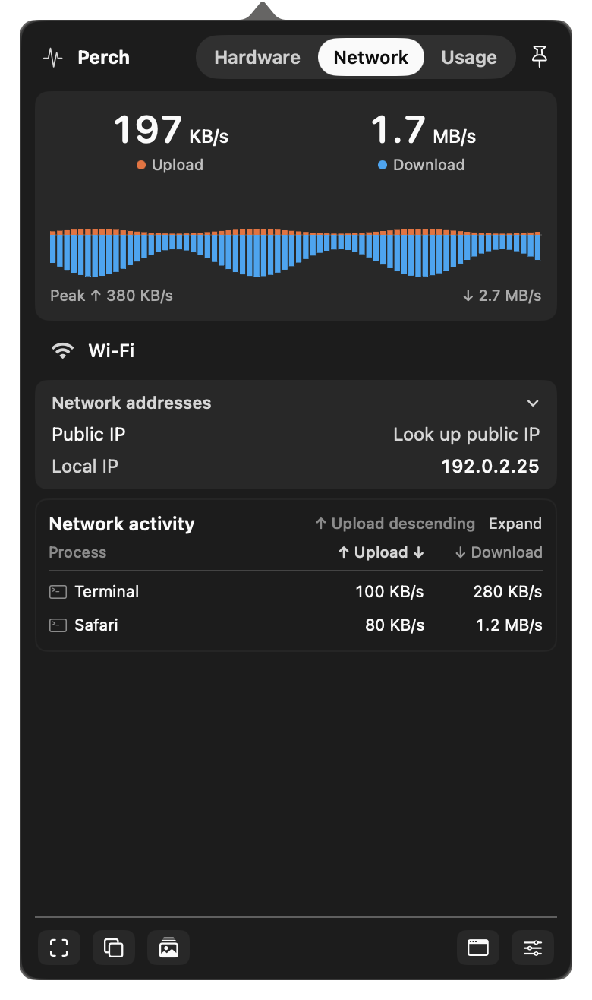
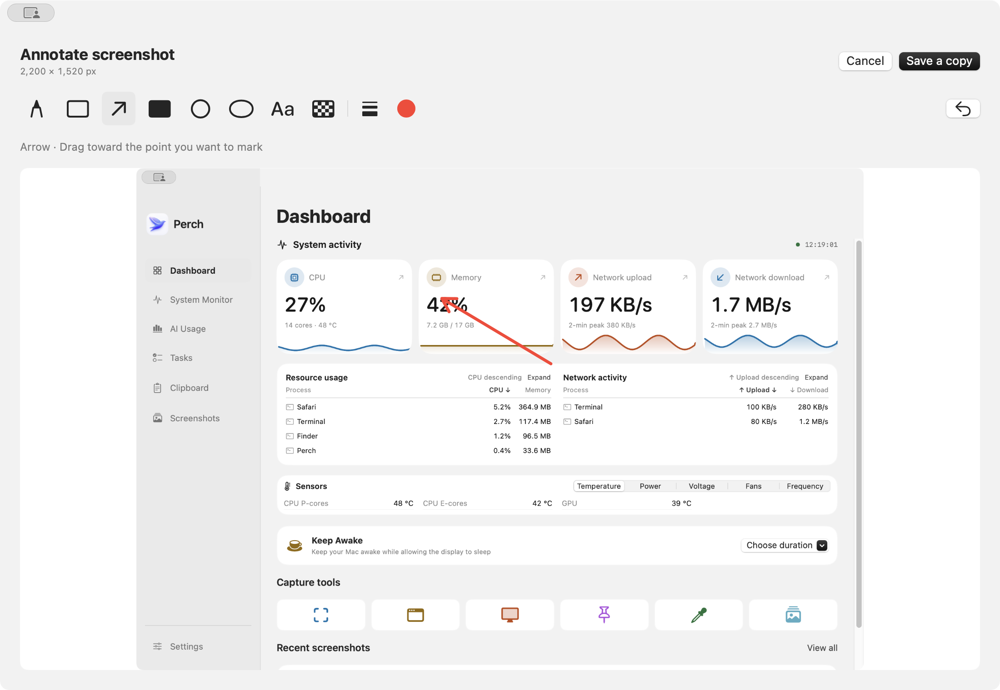
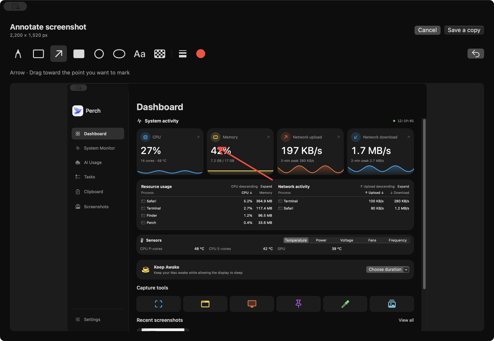
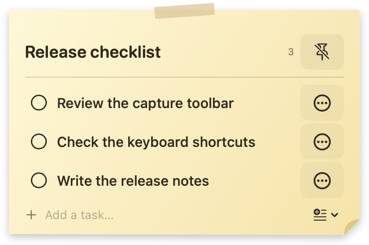

<p align="center"></p>

# Perch

Perch is a native desktop toolkit for macOS and Windows. Capture and annotate part of your screen, bring back something you copied, or pin a checklist to your desktop. The same workspace shows live system activity and token usage from your local AI tools.

## Screenshots

English screenshots from the running macOS app use sample readings, sessions, tasks and clipboard entries. Open a thumbnail to see its full-size capture.

| Dashboard · Light | Dashboard · Dark |
| --- | --- |
| [](docs/screenshots/macos-dashboard-light.png) | [](docs/screenshots/macos-dashboard-dark.png) |

### Menu bar

The readouts show CPU temperature or load, network throughput and today's tokens. Click a readout for details, right-click for shortcuts, or use the coffee cup to set a keep-awake timer.


| Hardware popover | Network popover | Shortcut menu |
| --- | --- | --- |
| [](docs/screenshots/macos-panel-light.png) | [](docs/screenshots/macos-network-dark.png) | [](docs/screenshots/macos-menu-light.png) |

### Tools

| Screenshot editor · Light | Screenshot editor · Dark |
| --- | --- |
| [](docs/screenshots/macos-annotation-light.png) | [](docs/screenshots/macos-annotation-dark.png) |

| Clipboard history | Pinned desktop checklist |
| --- | --- |
| [](docs/screenshots/macos-clipboard-dark.png) | [](docs/screenshots/macos-note-light.png) |

The [full gallery](docs/screenshots/) also includes the AI Usage window, with daily token breakdowns and a ring calendar. The two Windows chart images are offscreen previews. [Capture instructions](#reproduce-the-screenshots) cover full Windows screenshots in English.

## Features

| Tool | What you can do |
| --- | --- |
| System monitor | Track CPU, memory, disk activity, and upload and download rates. Inspect core load, processes and the sensors your hardware exposes. Glance at readings from the Mac menu bar or beside the Windows notification area. |
| AI usage | Filter Codex, Claude Code and OpenClaw sessions by tool. Explore the daily token breakdown, monthly activity rings, models, projects and session titles. Export CSV or JSON. Codex and direct Anthropic connections can show remaining quota when a valid local snapshot is available. |
| Screenshots | Capture a region, window or display. Add arrows, shapes, movable text or mosaic blocks. Pin a capture, extract its text, or reveal the original file from the gallery. |
| Clipboard | Search clipboard history, pin frequently used items and paste a previous entry. Choose plain text when the original formatting gets in the way. |
| Tasks and notes | Keep several tasks on one desktop note and edit them in place. Set a due date and a separate reminder time. |
| Keep awake | Start a preset or custom timer, or keep the computer awake until you stop it. The display can still turn off. |

Perch includes English and Simplified Chinese interfaces, light and dark themes, configurable shortcuts and launch at login.

## Build from source

Run these commands from the repository root.

### macOS

Use macOS 13 or later with Xcode or its Command Line Tools and a compatible macOS SDK. The build uses Swift, AppKit, SwiftUI and C and targets the architecture of the build machine. Sensor coverage varies by Mac model.

```sh
bash macos/Scripts/build.sh
open macos/build/Perch.app
bash macos/Scripts/test.sh
```

The build script uses a local signing identity when available and falls back to ad-hoc signing. To select a certificate explicitly, set `SIGNING_IDENTITY` before building. Grant Screen Recording access on the first direct capture. Grant Accessibility access to paste from clipboard history into another app. Allow notifications to receive task reminders.

### Windows

Use Windows 10 or 11 with Visual Studio Build Tools, the .NET desktop build tools and the .NET Framework 4.8 targeting pack. Run in PowerShell.

```powershell
.\windows\scripts\build.ps1 -Test
.\windows\bin\Release\Perch.exe
```

Windows OCR uses the recognition languages installed on the machine. Task reminders use the current user's Task Scheduler and require an interactive sign-in.

## Default shortcuts

| Action | macOS | Windows |
| --- | --- | --- |
| Capture a region | F1 | F1 |
| Cancel a capture | Esc | Esc |
| Pin clipboard text or an image | F3 | F3 |
| Hide or show pinned captures | Shift + F3 | Shift + F3 |
| Open clipboard history | Shift + Command + C | Ctrl + Shift + C |

Settings shows the active binding if a default shortcut is already in use. On a Mac with media keys, hold Fn to send a function key.

## Local data

Perch reads usage records written by the supported AI tools. The indexer recognizes `CODEX_HOME`, `CLAUDE_CONFIG_DIR` and `OPENCLAW_STATE_DIR`. Token totals describe the records available on this machine. Custom Claude endpoints can contribute token counts without a verified subscription quota.

Perch stores screenshots, tasks, clipboard history and the usage index in the current user's data directory. Windows settings also live there. macOS interface preferences use the system preferences database. On the first launch after upgrading, Perch moves the previous data directory (`ScopeBar` on macOS or `DeskToys` on Windows) to the new location if that location does not yet exist. Quit the older version before upgrading. If both directories already exist, Perch uses the new one and preserves the old one for manual recovery.

| Platform | Data directory |
| --- | --- |
| macOS | `~/Library/Application Support/perch/` |
| Windows | `%LOCALAPPDATA%\perch\` |

## Repository layout

| Directory | Contents |
| --- | --- |
| [macos/](macos/) | Swift and C sources, localized resources, build scripts and tests |
| [windows/](windows/) | Windows Forms source, OCR helper, build scripts and tests |
| [assets/](assets/) | Shared high-resolution app icon |
| [docs/screenshots/](docs/screenshots/) | English light and dark images |
| [tools/screenshots/](tools/screenshots/) | Documentation-only capture utilities with sample data |

## Reproduce the screenshots

Run this command from a graphical macOS session.

```sh
bash tools/screenshots/macos/capture.sh
```

On Windows, run the following in a Developer PowerShell with MSBuild on the path. The utility captures the dashboard, AI usage, network popover, tray shortcut menu and desktop checklist in both themes. It uses temporary sample data. You can also double-click the built `Perch.Screenshots.exe` to save the PNGs in a `Perch screenshots` folder beside the executable.

```powershell
msbuild tools/screenshots/windows/Screenshots.csproj /nologo
.\tools\screenshots\windows\bin\Perch.Screenshots.exe docs/screenshots
```

A manual [Windows screenshots workflow](.github/workflows/screenshots.yml) runs the same capture and provides a downloadable artifact named `windows-screenshots`.

## License

[MIT License](LICENSE).
