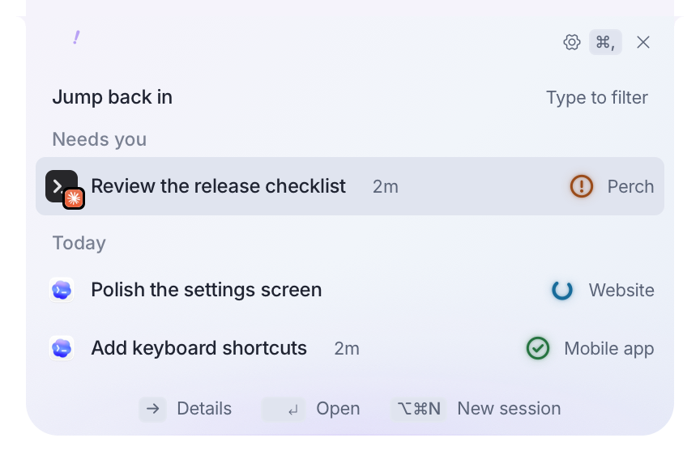
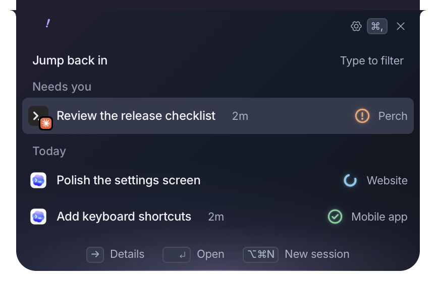
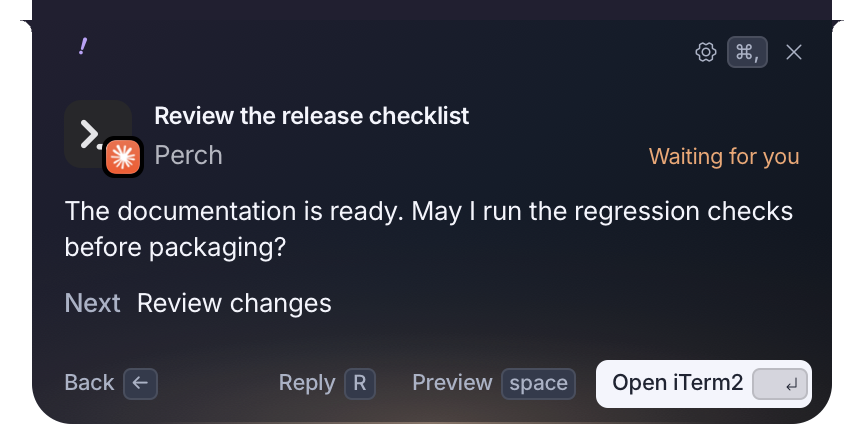
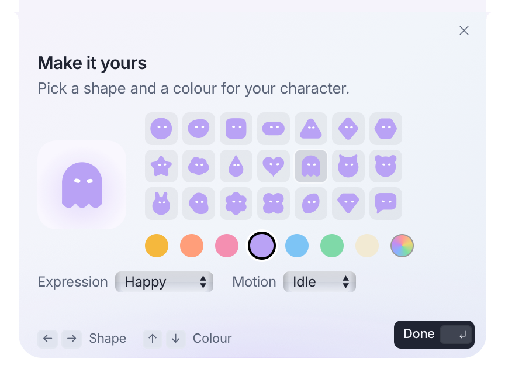
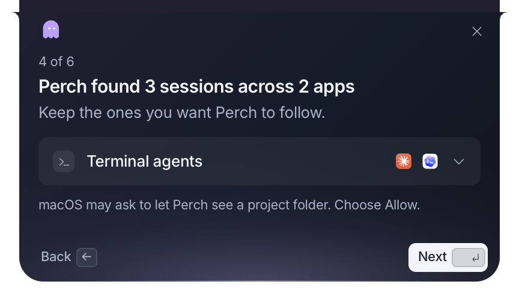
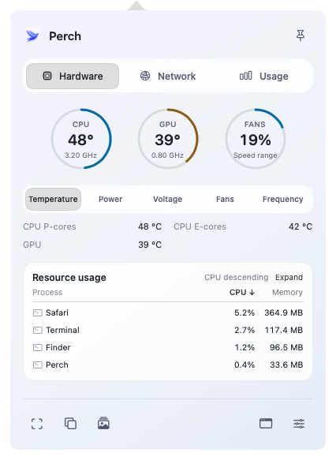
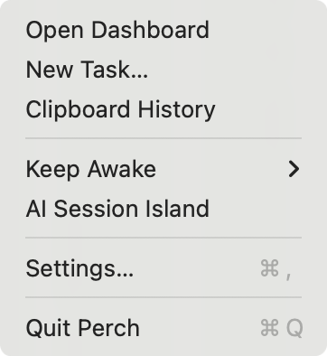
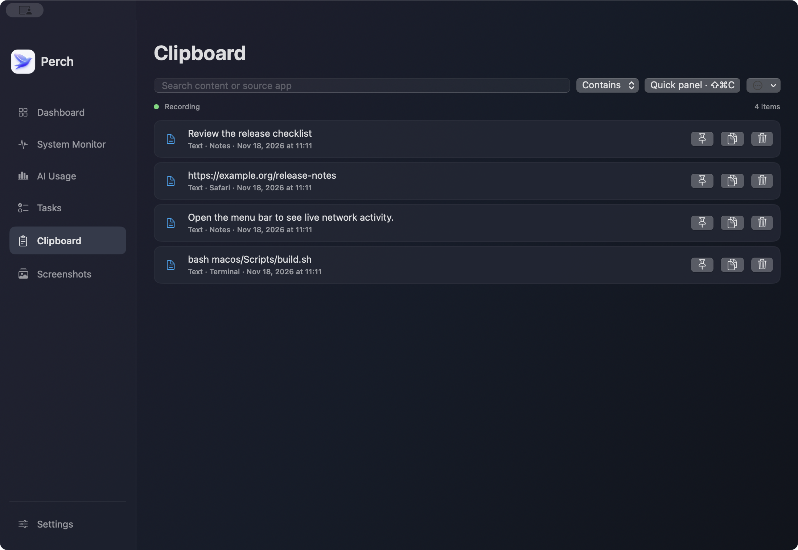

<p align="center"></p>

# Perch

Perch brings everyday desktop tools and AI coding sessions into one workspace for macOS and Windows. Monitor your system, capture and annotate screenshots, search clipboard history, and keep editable checklists on your desktop. On macOS, a session island helps you see when Claude Code or Codex needs your attention, read recent exchanges, and return to the right conversation.

[Download the latest release](https://github.com/azhouyufei/perch/releases/latest) · [Features](#features) · [Build from source](#build-from-source) · [Acknowledgements](#acknowledgements)

The macOS app uses SwiftUI, AppKit and WebKit; the Windows app uses Windows Forms. They share the desktop toolkit, while the macOS session island and Windows animated alerts have different interfaces and capabilities.

## Screenshots

English captures of the current macOS interface use isolated sample readings, sessions, tasks and clipboard entries. No personal conversations, clipboard contents or account credentials appear in these images. Open a thumbnail to see the full-size capture.

| Dashboard · Light | Dashboard · Dark |
| --- | --- |
| [](docs/screenshots/macos-dashboard-light.png) | [](docs/screenshots/macos-dashboard-dark.png) |

### AI session island

| Sessions · Light | Sessions · Dark |
| --- | --- |
| [](docs/screenshots/macos-island-light.png) | [](docs/screenshots/macos-island-dark.png) |

| Session card | Character settings | Setup guide |
| --- | --- | --- |
| [](docs/screenshots/macos-conversation-dark.png) | [](docs/screenshots/macos-character-light.png) | [](docs/screenshots/macos-setup-dark.png) |

### Menu bar

The readouts show CPU temperature or load, network throughput and today's locally recorded tokens. Click a readout for details, right-click for shortcuts, or use the coffee cup to set a keep-awake timer.


| Hardware popover | Network popover | Shortcut menu |
| --- | --- | --- |
| [](docs/screenshots/macos-panel-light.png) | [](docs/screenshots/macos-network-dark.png) | [](docs/screenshots/macos-menu-light.png) |

### Tools

| Screenshot editor · Light | Screenshot editor · Dark |
| --- | --- |
| [](docs/screenshots/macos-annotation-light.png) | [](docs/screenshots/macos-annotation-dark.png) |

| Clipboard history | Pinned desktop checklist |
| --- | --- |
| [](docs/screenshots/macos-clipboard-dark.png) | [](docs/screenshots/macos-note-light.png) |

The [full gallery](docs/screenshots/) includes both themes for the usage dashboard, tools and island. Windows screenshots will be supplied separately; the existing Windows chart images are older offscreen previews, not captures of this release.

## Features

| Tool | What you can do |
| --- | --- |
| System monitor | Track CPU, memory, disk activity, and upload and download rates. Inspect core load, processes and the sensors your hardware exposes. Glance at readings from the Mac menu bar or beside the Windows notification area. |
| AI usage | Filter Codex, Claude Code and OpenClaw sessions by tool. Explore the daily token breakdown, monthly activity rings, models, projects and session titles. Export CSV or JSON. On macOS, Codex quota comes from the currently signed-in account API; direct Anthropic connections use verified status-line snapshots. |
| Screenshots | Capture a region, window or display. Add arrows, shapes, movable text or mosaic blocks. Pin a capture, extract its text, or reveal the original file from the gallery. |
| Clipboard | Search clipboard history, pin frequently used items and paste a previous entry. Choose plain text when the original formatting gets in the way. |
| Tasks and notes | Keep several tasks on one desktop note and edit them in place. Set a due date and a separate reminder time. |
| AI session alerts | Follow Claude Code and Codex in the macOS session island. Use the setup guide, session cards and 21 configurable avatar shapes. Windows uses animated desktop alerts with a copyable resume command. |
| Keep awake | Start a preset or custom timer, or keep the computer awake until you stop it. The display can still turn off. |

Perch includes English and Simplified Chinese interfaces, light and dark themes, configurable shortcuts and launch at login. On macOS, the workspace, menu bar panel and session island share a soft blue–violet gradient. Choose Light, Dark or System in Settings → Appearance; open panels update immediately without restarting.

## AI session island on macOS

Choose **AI Session Island** from the menu bar item's context menu, or open **Preferences → AI Session Island → Setup guide**. The guide covers the character, Accessibility for sending replies, the keyboard shortcut, session sources and live hooks. The island opens at the top of the selected display, including external monitors without a camera notch.

Codex project conversations are read from its local thread index, paginated history and available rollout files, with one row per thread. Choose **Default terminal** in the main Preferences to open new or resumed terminal sessions in iTerm2. The automatic option follows your most recently used terminal.

Open a session card to read its recent exchange, reply or return to the originating app. Claude Code permission requests and structured questions can be answered directly when its hook is holding the request. For Codex approvals, open the originating session. Perch can route ordinary replies to a supported terminal or app and reports when it cannot send them.

ChatGPT Work conversations in the combined desktop app are also listed under the Codex source, using their parent conversation titles from the desktop app's local catalog. These chats have different IDs from their executor threads and may have no local rollout or working directory. **Pick up** opens the corresponding ChatGPT web conversation. Ordinary personal chats are excluded. Work cards do not offer local CLI rename/delete or automatic reply actions. A fresh desktop activity marker can show that a Work chat is running; absent markers are shown as unknown progress, never inferred completion. Detailed Work transcripts, permission prompts, and reliable completion notifications are not currently exposed by this catalog.

Use **Character appearance** to preview the 21 blob-avatar shapes, choose a swatch or a custom colour, and set the resting expression and motion. The same character reacts to requests and appears on session cards. Character settings persist between launches.

Enable Claude Code or Codex individually in Preferences. Start a new session after enabling a hook and accept Codex's hook trust prompt if shown. Perch reads local session history and receives events through a user-only Unix socket under `~/Library/Application Support/perch/island`. Hook installation respects `CLAUDE_CONFIG_DIR` and `CODEX_HOME` as seen by the running app.

### Windows session alerts

In **Preferences → AI session alerts**, enable Claude Code, Codex, or both. Native Windows sessions deliver approval and question alerts to a desktop sprite. Review the request in the original session or use **Copy resume command** for a CLI session. The local listener stores only the metadata needed for the alert.


## Build from source

Run these commands from the repository root.

### macOS

Install Go 1.22 or later to build the bundled agent hook helper on either platform.

Use macOS 13 or later with Xcode or its Command Line Tools and a compatible macOS SDK. The build uses Swift, AppKit, SwiftUI and C and targets the architecture of the build machine. Sensor coverage varies by Mac model.

```sh
bash macos/Scripts/build.sh
open macos/build/Perch.app
bash macos/Scripts/test.sh
```

The build script uses a local Apple Development or Developer ID Application signing identity and remembers the successful identity in the ignored `macos/build/signing-identity` file. To select your Xcode personal certificate explicitly, set `SIGNING_IDENTITY` to its SHA-1 from `security find-identity -v -p codesigning`. Missing certificates now stop the build instead of silently switching to ad-hoc signing, which invalidates permission identity between updates. `ALLOW_ADHOC_SIGNING=1` is available only for explicit local test builds.

To sign an already-built app with your Xcode personal Apple Development certificate, run `bash macos/Scripts/sign-personal.sh`. It signs both the app and helper, verifies the signature, and creates a `-personal.zip` package. If multiple certificates are present, select yours with `SIGNING_IDENTITY`. Personal development signing is for local use; public distribution should use Developer ID signing and notarization. Changing from ad-hoc to certificate signing may require granting permissions once again. Grant Screen Recording access on the first direct capture. Grant Accessibility access to paste from clipboard history into another app. Allow notifications to receive task reminders.

### Windows

Use Windows 10 or 11 with Visual Studio Build Tools, the .NET desktop build tools and the .NET Framework 4.8 targeting pack. Run in PowerShell.

```powershell
.\windows\scripts\build.ps1 -Test
.\windows\bin\Release\Perch.exe
```

Windows OCR uses the recognition languages installed on the machine. Task reminders use the current user's Task Scheduler and require an interactive sign-in.

## Default shortcuts

| Action | macOS | Windows |
| --- | --- | --- |
| Capture a region | F1 | F1 |
| Cancel a capture | Esc | Esc |
| Pin clipboard text or an image | F3 | F3 |
| Hide or show pinned captures | Shift + F3 | Shift + F3 |
| Open clipboard history | Shift + Command + C | Ctrl + Shift + C |

Settings shows the active binding if a default shortcut is already in use. On a Mac with media keys, hold Fn to send a function key.

## Local data

Perch reads usage records written by the supported AI tools. The indexer recognizes `CODEX_HOME`, `CLAUDE_CONFIG_DIR` and `OPENCLAW_STATE_DIR`. Token totals describe the records available on this machine, not total account consumption. If the selected day or tool has no readable records, macOS shows an em dash rather than zero. ChatGPT Work conversations without token records are excluded even when their titles appear in the session island. Account allowance is displayed separately and is never converted into a token estimate. On macOS, Codex remaining quota is queried from the locally signed-in Codex account through `account/rateLimits/read` once per minute while a usage view is active; manual refresh queries immediately. The `codex` entry in `rateLimitsByLimitId` takes precedence over the legacy single-bucket response. Historical transcript limits never replace failed account queries. This uses Codex's existing authentication and requires a compatible local Codex installation and network access; a different CLI login may differ from the account in the desktop app. Custom Claude endpoints can contribute token counts without a verified subscription quota.

Perch stores screenshots, tasks, clipboard history and the usage index in the current user's data directory. Windows settings also live there. macOS interface preferences use the system preferences database. On the first launch after upgrading, Perch moves the previous data directory (`ScopeBar` on macOS or `DeskToys` on Windows) to the new location if that location does not yet exist. Quit the older version before upgrading. If both directories already exist, Perch uses the new one and preserves the old one for manual recovery.

| Platform | Data directory |
| --- | --- |
| macOS | `~/Library/Application Support/perch/` |
| Windows | `%LOCALAPPDATA%\perch\` |

## Repository layout

| Directory | Contents |
| --- | --- |
| [macos/](macos/) | Swift and C sources, localized resources, build scripts and tests |
| [windows/](windows/) | Windows Forms source, OCR helper, build scripts and tests |
| [assets/](assets/) | App icon, generated avatar sprites and license notices |
| [agent/](agent/) | Go helper for local agent hook events |
| [macos/Island/](macos/Island/) | Adapted session-island modules, web UI and third-party notices |
| [docs/screenshots/](docs/screenshots/) | English light and dark images |
| [tools/screenshots/](tools/screenshots/) | Documentation-only capture utilities with sample data |

## Reproduce the screenshots

Run this command from a graphical macOS session.

```sh
bash tools/screenshots/macos/capture.sh
```

On Windows, run the following in a Developer PowerShell with MSBuild on the path. The utility captures the dashboard, AI usage, network popover, tray shortcut menu and desktop checklist in both themes. It uses temporary sample data. You can also double-click the built `Perch.Screenshots.exe` to save the PNGs in a `Perch screenshots` folder beside the executable.

```powershell
msbuild tools/screenshots/windows/Screenshots.csproj /nologo
.\tools\screenshots\windows\bin\Perch.Screenshots.exe docs/screenshots
```

A manual [Windows screenshots workflow](.github/workflows/screenshots.yml) runs the same capture and provides a downloadable artifact named `windows-screenshots`.

## Acknowledgements

Thank you to the authors and contributors whose work made this project possible.

| Project | How Perch uses or references it | Attribution |
| --- | --- | --- |
| [asafofer/perch](https://github.com/asafofer/perch) — Asaf Ofer and contributors | The macOS island's native panel, geometry, session routing, hook protocol, setup guide and WebKit UI are adapted from this project. | MIT; [retained notice](macos/Island/LICENSE) and [pinned source revision](macos/Island/README.md). |
| [blob-avatar](https://github.com/c0le0ni/blob-avatar) — Michel Coleoni | Interactive island character, shape/colour/expression/motion controls, and generated Windows alert sprites. | MIT; [web component notice](macos/Island/blob-avatar.LICENSE), [sprite notice](assets/agent-avatar/LICENSE). |
| [Phosphor Icons](https://github.com/phosphor-icons/core) | Icons included in the adapted island UI. | MIT notice retained in [app.js](macos/Island/ui/app.js). |
| [Inter](https://github.com/rsms/inter) | Bundled typeface used by the island UI. | [SIL Open Font License 1.1](macos/Island/ui/dist/fonts/OFL.txt). |
| [Tailwind CSS](https://github.com/tailwindlabs/tailwindcss) | Utility styles in the upstream island's bundled stylesheet. | MIT header retained in [ui.css](macos/Island/ui/dist/ui.css). |
| [Maccy](https://github.com/p0deje/Maccy) | Reference for a fast, searchable clipboard workflow. | Design reference; the Maccy application is not bundled. |
| [awesome-macOS](https://github.com/iCHAIT/awesome-macOS) | A useful source for discovering desktop utility ideas and projects. | Reference collection, not a runtime dependency. |

[iStat Menus](https://bjango.com/mac/istatmenus/) and [Snipaste](https://www.snipaste.com/) also informed the monitoring and screenshot workflows. They are product references, not open-source dependencies or bundled applications.

This repository is an independent desktop-toolkit project. Its shared name does not imply affiliation with or endorsement by asafofer/perch or the other projects above. Original copyright and license notices are preserved; see the [island source notes](macos/Island/README.md) for exact upstream revisions.

## License

Perch's original code is available under the [MIT License](LICENSE). Third-party code, fonts and assets retain their respective licenses listed above.
